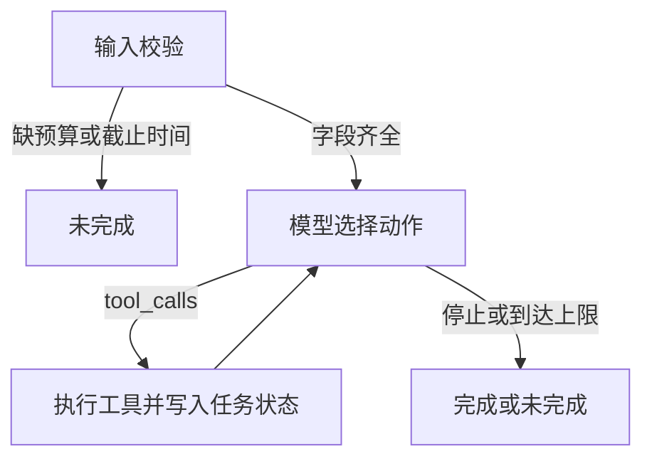

# 方案

## 调用流程

CLI 先检查主题、预算和截止时间。缺预算或截止时间时直接返回未完成，不进入模型循环。字段齐全后，`create_agent` 开始循环：

1. 模型选择一个工具，并在回复里写一句依据。
2. 工具执行，把 JSON 观察结果交回模型。
3. 模型决定下一个工具，或停止。

工具调用默认上限 8 次。到达上限时，后续工具不再执行业务逻辑，结果状态为 `incomplete`，原因是 `max_steps`。图递归上限只作为兜底，避免模型不停调用。

## 框架负责什么

使用的版本：

- `langchain==1.4.9`：`create_agent` 提供 ReAct 循环、系统提示和工具调用
- `langgraph==1.2.20`：作为 `create_agent` 的运行时，提供 `MemorySaver`、`recursion_limit`，并在超出图步数时抛出 `GraphRecursionError`
- `langchain-openai==1.7.4`：`ChatOpenAI` 连接 OpenAI 兼容接口

没有使用旧的 `AgentExecutor`。`create_react_agent` 在当前版本已改为 `create_agent`，所以主入口用后者。

框架状态是 `messages`。步骤成败、费用合计和已保存方案不放进 LangGraph state，而是放在项目自己的 `TaskState`。消息里能看到工具原文，但框架不会把失败步骤标成失败，也不会只合计最终方案。

## 项目自己负责什么

这些是执行骨架，不代替模型选择下一个工具：

- 步骤日志只追加。失败记录保持失败。
- 费用合计只取已保存方案。试算的 12 不和 8 相加。
- 工具失败返回 `ok: false`，不抛异常打断循环，也不在工具内部自动重试。
- `save_plan` 在缺少成功脚本、缺少成功估算、超预算或超期时拒绝，并把原因交回模型。
- 方案按“主题 + 方案类型”去重。再次保存返回原编号，费用不增加。
- Trace 从已经发生的消息里摘出步骤、参数、返回摘要、后续动作和依据。

代码里没有 `if cost > budget: 改选 lean`。系统提示 `skeleton-v1` 只规定先看标准方案，超限后可以改看精简方案。真正发出下一次工具调用的是模型。第一次真实运行就走出了“12 之后改选 lean”的路径，提示词没有再改。

`FlowMockModel` 内部有脚本化分支，只在 `--mode mock` 或需要离线流程测试时使用。它的输出 `proves_model_decision` 为 `false`。

## 取舍

选择 `create_agent`，是因为考核要的就是“模型选工具、执行、观察、再决定”，而这个工厂已经提供该循环。自己再写一套文本 ReAct 解析，不能提高决策质量，还会增加解析失败。

业务规则留在工具返回值和 `TaskState`，是为了让评审能核对预算、步骤依赖和失败状态。这些账本如果只存在聊天消息里，后一次成功无法明确保留前一次失败。

脚本使用本地模板，是因为题目允许业务工具用本地函数。需要模型决定的是调用哪个工具，不是脚本句子本身。
